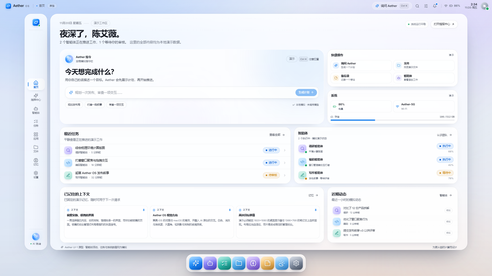
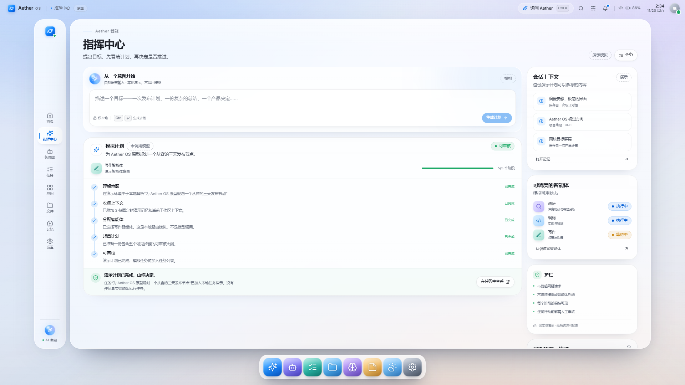
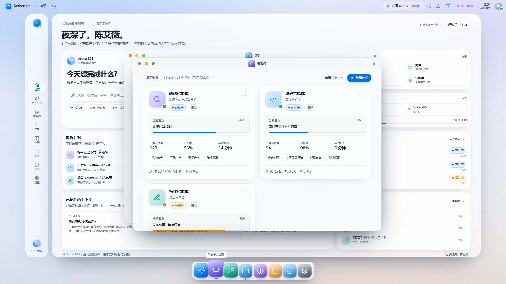

# Aether OS — UI Prototype

An interactive, local-only desktop prototype for **Aether OS**, an AI-native operating system concept. The experience blends the clarity of iOS with the productivity of macOS and a calm, agent-first interaction model.

The interface launches in **Simplified Chinese** by default. English is available at any time from **Settings → Appearance → Language**; the choice persists in this browser. Every page, window, tooltip, accessible name and piece of demo data follows the active language.

> **This is a UI prototype, not an operating system.** There is no backend, model, agent runtime, file-system access or network traffic in the app. Tasks, agents, memories, files, notifications and system telemetry are clearly labelled **demo data**.



## Run it

Requirements: Node.js 20+ and npm.

```bash
npm install
npm run dev
```

Open the URL printed by Vite — normally <http://localhost:5173>.

Production build:

```bash
npm run build
npm run preview
```

## What is included

| Surface | Highlights |
| --- | --- |
| **Desktop** | Soft gradient wallpaper, menu bar, navigation rail, glass workspace, magnification dock, control center, notifications and user menu. |
| **Home** | Time-aware welcome, global Aether command bar, recent demo tasks, live agent pulse, quick actions, system widget, and full-HD context/activity cards. |
| **Command Center** | Natural-language input, five-stage simulated plan, progress, cancellation and a hand-off into Tasks. Every plan is explicitly labelled as a local simulation. |
| **Agents** | Research, Coding and Writing agent cards with focus, progress, stats, capabilities and a detail sheet with simulated activity. |
| **Tasks** | Status filters, search, a spacious task list and a full task-detail sheet with plan timeline and provenance. Simulated Command Center plans appear automatically. |
| **Apps** | Eight-app library. Launching an app opens a real interactive window; running windows can be brought forward rather than duplicated. |
| **Files** | Fully local demo drive: folder navigation, breadcrumbs, list/grid views, global search, file previews and abstract image artwork. |
| **Memory** | Inspectable local context cards, category filters, search, pin/unpin, pause/resume memory and demo provenance. |
| **Settings** | Working appearance (light/dark/system), accent, wallpaper, dock magnification, clock seconds, reduce motion, memory controls, system information and a two-step demo reset. |
| **Mini-apps** | A functional local Notes window and a detailed, static mock Weather window. |

### A look inside





### UI-1.2 — Simplified Chinese first, English optional

- **Default locale:** Simplified Chinese. The language can be switched instantly in Settings and is remembered across reloads.
- **Complete UI localization:** 687 typed message keys per language across desktop, Home, Command Center, Agents, Tasks, Apps, Files, Memory, Settings, Notes, Weather, windows, Dock, Control Center, notifications, user menu and the command palette.
- **Bilingual demo data:** 369 `LocalizedText` fields across agents, tasks, files, memories, notifications, navigation, apps and system/weather data. Generated Command Center plans and tasks are bilingual too.
- **Chinese typography:** no forced uppercase micro-labels, comfortable CJK line-height, natural wrapping, and no font shrinking to force content to fit.
- **Layout verified:** both languages are checked at 1920×1080 and 1366×768 with zero horizontal overflow; the Chinese Home fits entirely above the fold at 1366×768.
- **Bilingual evidence:** 62 real Playwright screenshots in [`docs/screenshots/ui-1.2`](docs/screenshots/ui-1.2), including Chinese/English pages at both sizes, windows, overlays and a completed simulated plan.

Full coverage and implementation notes: [docs/i18n-coverage.md](docs/i18n-coverage.md). The original design rationale remains in [docs/i18n-plan.md](docs/i18n-plan.md).

### UI-1.1 visual polish

The UI-1.1 pass established the current visual baseline:

- A compact Home rhythm keeps every primary card above the fold at 1366×768.
- Windows cascade predictably, distinguish the focused window, and use compact in-window headers (no duplicated page title).
- Light-theme muted text and accent tokens meet WCAG AA contrast for normal text on the app surface.
- Page transitions no longer use filter blur, which removes a backdrop-filter compositing artifact in repeated captures.
- Window actions open their target as an app window instead of silently changing the page behind it.

Historical before/after evidence: [Home at 1366×768](docs/screenshots/ui-1.1/compare-home-1366.png) · [multi-window](docs/screenshots/ui-1.1/compare-multi-window-1920.png) · [Command Center](docs/screenshots/ui-1.1/compare-command-center-1920.png).

### Window system

Open and close windows, drag them by the title bar, minimize and restore from the Dock, double-click the title bar (or use the green light) to maximize, and pin a window above the rest. Focus order, window shadows, traffic lights and Dock indicators are all real interactive state.

### Keyboard and accessibility

- **Ctrl/⌘ K** — open the global Aether command palette.
- **Esc** — close menus, sheets and overlays.
- All traffic lights, Dock apps and controls have accessible names; dialogs and filters expose ARIA state.
- Reduced-motion support is available in Settings and respects the OS setting.

## Tech stack

React 19 · TypeScript · Vite 7 · Tailwind CSS 3.4 · Framer Motion · Lucide icons · Vitest + Testing Library · Playwright (Edge).

No UI component library is used; the interface was built from a small local design system (`src/index.css`, `src/components/ui`).

## Project structure

```text
aether-os/
├─ docs/
│  ├─ screenshots/              # README imagery, UI-1.1 evidence, UI-1.2 bilingual captures
│  ├─ i18n-plan.md              # Chinese-first localization design and migration plan
│  └─ i18n-coverage.md          # implemented coverage, counts and language behavior
├─ scripts/
│  ├─ build.mjs                 # self-contained production build wrapper
│  └─ capture-ui-1.2.mjs        # reproducible Chinese/English screenshot capture
├─ src/
│  ├─ components/
│  │  ├─ agents/  tasks/        # page-specific components
│  │  ├─ apps/                  # Notes + Weather windows
│  │  ├─ command/               # Command Center composer, plan, context
│  │  ├─ common/                # avatars, badges shared across pages
│  │  ├─ desktop/               # desktop shell + wallpaper
│  │  ├─ files/  memory/        # Files and Memory browser/cards
│  │  ├─ home/                  # Home bento widgets
│  │  ├─ layout/                # menu bar, rail, dock, overlays
│  │  ├─ settings/              # appearance, desktop, privacy, system
│  │  ├─ ui/                    # local design-system primitives
│  │  └─ windows/               # window frame, layer and content registry
│  ├─ data/                     # rich, clearly-labelled bilingual demo data
│  ├─ i18n/                     # typed dictionaries, LocalizedText, provider and hook
│  ├─ lib/                      # formatting, simulation and helpers
│  ├─ pages/                    # eight workspace surfaces
│  ├─ state/                    # settings, demo data, desktop, window stores
│  ├─ test/                     # Vitest setup
│  ├─ App.tsx                   # provider composition only
│  ├─ index.css                 # design tokens, glass, wallpaper, motion
│  └─ main.tsx
├─ tests/e2e/                   # Playwright interaction suites
├─ index.html
├─ playwright.config.ts
├─ tailwind.config.cjs
└─ vite.config.ts
```

## Verification

```bash
npm run lint        # ESLint, zero errors/warnings
npm test            # Vitest: 19 tests (includes i18n dictionary and demo-data coverage)
npm run build       # typecheck + production bundle
npm run test:e2e    # Playwright: 46 checks at 1920×1080 and 1366×768 (44 pass, 2 intentional viewport skips)
```

Playwright uses the installed Microsoft Edge channel, so no browser download is required on Windows 11. The preview server starts automatically.

The local build wrapper points child-process temp files at the gitignored `.tmp/` folder. That makes `npm run build` self-contained on Windows hosts where the default OS temp directory denies esbuild's temporary-file cleanup.

## Demo-only boundaries

- No real model, agent backend, API, network request, filesystem access or system integration.
- Agent execution is a deterministic, local five-stage planning simulation.
- Appearance/preferences — including the chosen language — persist in `localStorage`; demo data resets on reload or from Settings.
- Window positions, open windows and Notes contents live only for the current session.
- The Command Center never pretends a model ran. Completed plans become clearly labelled **Simulated plan** tasks.
